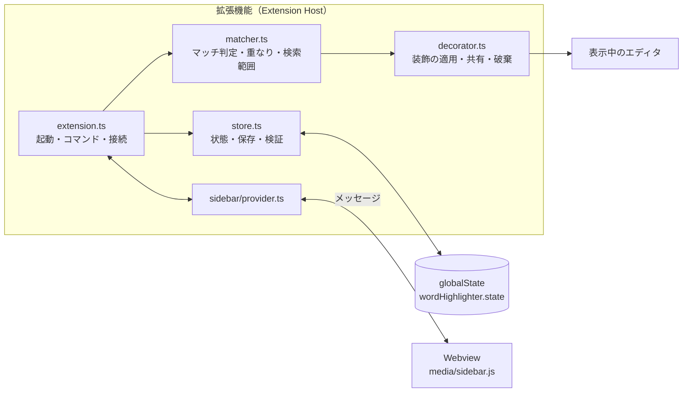
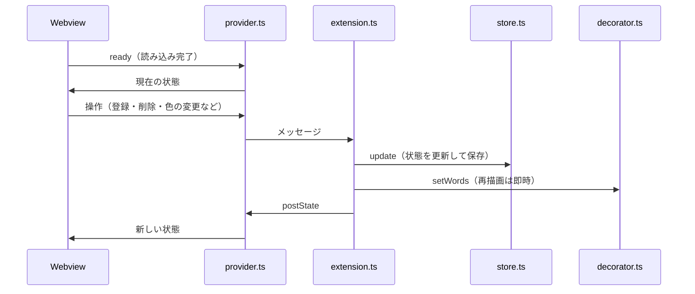

# 設計

## 全体構成

- 状態の正は拡張機能側が持ち、Webview は表示専用（[ADR 0005](adr/0005-webview-is-display-only.md)）。
- vscode に依存しない処理（`store.ts`、`matcher.ts`、`sidebar/html.ts`）を分け、VS Code を起動せずにテストする（[ADR 0006](adr/0006-headless-tests-with-node-test.md)）。

## ディレクトリ構成と各モジュールの責務

| パス | 責務 |
|---|---|
| `src/extension.ts` | 起動、コマンドの登録、各部品の接続。状態の変更を装飾・コンテキストキー・サイドバーに反映する |
| `src/store.ts` | `globalState` への保存・読み込み・検証・移行と、状態を変える操作（vscode に依存しない） |
| `src/matcher.ts` | マッチ判定、単語境界（VS Code の `isValidMatch` 相当）、重なりの分割、検索範囲（vscode に依存しない） |
| `src/decorator.ts` | 装飾の適用、(文字色, 背景色) ごとの装飾の共有と破棄、再描画の待ち時間 |
| `src/colors.ts` | パレットと、背景色の透明度（`BG_ALPHA`） |
| `src/types.ts` | 状態と、Webview とのメッセージの型 |
| `src/sidebar/provider.ts` | Webview ビューのプロバイダ |
| `src/sidebar/html.ts` | Webview の HTML（CSP と nonce） |
| `media/sidebar.js`、`media/sidebar.css` | Webview の画面 |
| `media/icon.svg` | アクティビティバーのアイコン（蛍光ペンの形） |
| `test/` | `node:test` によるテスト |
| `samples/word-match.txt` | 単語一致を VS Code の検索窓と見比べるための入力（vsix には含めない） |

## データの流れ

### 状態の変更

- Webview は非表示にすると破棄されるため、状態を持たない。表示状態が変わったときも、拡張機能側が状態を送り直す。
- 保存データが壊れていた場合、`store.ts` は保存を一切行わない（[spec.md](spec.md#エラー時の挙動)）。

### 描画
1. 再描画のきっかけ（編集・スクロール・表示中のエディタの変更・`editor.wordSeparators` の変更）では 150ms（`REFRESH_DELAY_MS`）待ってから、単語の変更や全体オン/オフではすぐに、表示中のすべてのエディタを処理する。
2. 表示範囲（`visibleRanges`）の前後300行（`SEARCH_MARGIN_LINES`）を検索範囲とし、重なる・隣接する範囲をまとめる。
3. 行ごとに、優先度の高い単語から位置を確保し、同じ色の組み合わせが続く区間を1つにまとめて、重ならない範囲を作る。
4. `TextEditorDecorationType` を (文字色, 背景色) の組み合わせごとに共有して適用する（`rangeBehavior` は `ClosedClosed`）。表示中のどのエディタでも使われなくなったものは破棄する。両方とも色なしの区間は装飾を作らない。

## 外部依存

- 実行時の依存ライブラリはない。VS Code API だけを使う。
- 開発用の依存（`devDependencies`）: TypeScript、esbuild（バンドル）、ESLint と typescript-eslint、`@vscode/vsce`（vsix の作成）、`@types/vscode`、`@types/node`。
- Webview は CSP（`default-src 'none'`、スタイルは拡張機能内の CSS ファイルのみ、スクリプトは nonce 付きのもののみ）を設定し、外部リソースを読み込まない。色などの動的なスタイルは、スクリプトから CSSOM で設定する。
